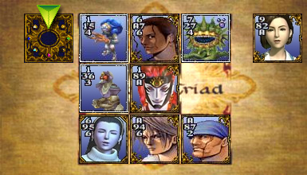
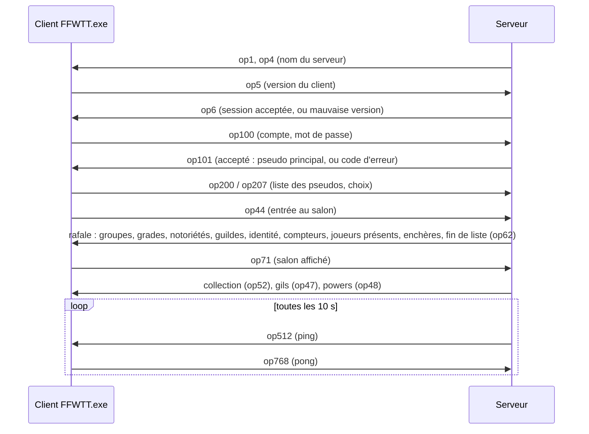

<p align="center">
  
  
</p>

# Serveur FFWorld Triple Triad

**Rejouez à FFWorld Triple Triad avec le vrai client du jeu, sur votre propre serveur.**

FFWorld Triple Triad (FFWTT) est un jeu de cartes en ligne français, adapté du Triple Triad de Final Fantasy VIII et
développé par MrJul pour FFWorld, un site de fans de Final Fantasy. Pendant des années, des joueurs s'y sont affrontés, ont collectionné des
milliers de cartes, échangé, misé, formé des guildes. Puis les serveurs officiels ont fermé : le client Windows
(`FFWTT.exe`, version 3.3.3.6065) existe toujours, mais il n'a plus rien à quoi se connecter.

Ce dépôt est un **serveur de remplacement complet**, écrit en Python. Le client d'origine s'y connecte **tel quel, sans
aucune modification** : on lui donne simplement l'adresse `ffwtt://HOTE:PORT`.

> *English: an independent, complete replacement server for the FFWorld Triple Triad 3.3.3.6065 Windows client (a French
> online card game based on Final Fantasy VIII's Triple Triad). The original client connects to it unmodified. The
> protocol was rebuilt by observing network traffic and reading the client binary. Pure Python 3.11+, no dependencies,
> SQLite storage, end-to-end tests. The game client itself is not included. Documentation is in French. GNU AGPL v3.*

## Pourquoi ce serveur

- **Préserver un jeu abandonné.** Sans serveur, le client ne sert plus à rien. Ici, tout le jeu revit : salon, chat,
  duels, collection, boutique, enchères, échanges, quizz, administration.
- **Jouer tout de suite, même seul.** Quatre robots de difficulté croissante sont toujours connectés ; il suffit de
  lancer le serveur et le jeu pour faire une partie.
- **Héberger sa propre communauté.** Une seule commande, sur un PC ou un petit serveur Linux : un vieux portable suffit.
  Ni base de données à installer, ni dépendance : Python et un fichier SQLite.
- **Fidèle à l'original.** Les trames ont été reconstruites octet par octet et comparées à des échanges réels ; les
  règles de capture rejouent une vraie partie à l'identique ; les prix et les « powers » des cartes sont calculés
  exactement comme le client les affiche. Les 4884 cartes du jeu sont fournies, avec leurs vraies valeurs.
- **Un protocole enfin documenté.** `FFWTT_protocole_notes.md` décrit chaque trame et précise, pour chacune, si elle a
  été observée ou seulement déduite du client. De quoi écrire d'autres outils, ou un jour un client web.
- **Sûr face aux tricheurs.** Le serveur ne fait aucune confiance à ce que le client lui envoie et revérifie tout (voir
  [Sécurité](#sécurité)).
- **Libre.** Le code est sous licence AGPL v3 : chacun peut l'étudier, l'améliorer et héberger son serveur.

## Démarrage rapide

Il faut **Python 3.11 ou plus récent**, rien d'autre. Sous Windows on lance Python avec `py`, ailleurs avec `python3`.

1. Récupérez ce dépôt (bouton *Code → Download ZIP*, ou `git clone`).
2. Lancez le serveur dans son dossier :
   ```
   py ffwtt_server.py --name MonServeur
   ```
3. Lancez le jeu en lui donnant l'adresse du serveur. Le jeu installé connaît les liens `ffwtt://` : ouvrez
   `ffwtt://127.0.0.1:27888` (par exemple avec *Windows + R*), ou passez l'adresse au programme :
   ```
   "C:\Program Files (x86)\FFWorld Triple Triad\FFWTT.exe" ffwtt://127.0.0.1:27888
   ```
4. Entrez un nom de compte et un mot de passe de votre choix : le compte est **créé à la première connexion** (5000 gils et
   20 cartes de départ). Nom : 3 à 20 lettres, chiffres ou `_ - [ ] .` ; mot de passe : 4 à 20 caractères.
5. **Le premier compte créé sur un serveur neuf est administrateur** (niveau 4, tous les droits) : c'est le vôtre, à
   condition de le créer avant d'ouvrir le serveur aux autres joueurs (par défaut, le serveur n'écoute que cette machine).
   Les comptes suivants sont de simples joueurs. Pour nommer d'autres administrateurs : `--admin` suivi d'un compte qui
   **existe déjà** (pris en compte au démarrage du serveur), ou, serveur arrêté, `py ffwtt_admin.py niveau Compte 4`.

**Pour jouer à plusieurs** sur un réseau local ou par Internet : lancez le serveur avec `--host 0.0.0.0`, ouvrez le port
TCP **27888** (pare-feu, box), et donnez aux joueurs l'adresse `ffwtt://VOTRE_ADRESSE:27888`.

### Sur un serveur Linux

```
python3 ffwtt_server.py --host 0.0.0.0 --name MonServeur
```

Sur une machine ouverte à Internet, créez votre compte (le premier, donc l'administrateur) juste après le premier
lancement, avant d'annoncer l'adresse du serveur ; ou lancez-le une première fois sans `--host 0.0.0.0` pour le créer en
local.

Pour qu'il tourne en permanence, un service systemd suffit (adapter l'utilisateur et le chemin) :

```ini
# /etc/systemd/system/ffwtt.service
[Unit]
Description=Serveur FFWorld Triple Triad
After=network.target

[Service]
User=ffwtt
WorkingDirectory=/opt/ffwtt
ExecStart=/usr/bin/python3 ffwtt_server.py --host 0.0.0.0 --name MonServeur
Restart=on-failure

[Install]
WantedBy=multi-user.target
```

La base `ffwtt.db` se crée au premier lancement dans le dossier du serveur : c'est le seul fichier à sauvegarder.

### Options

| Option | Effet |
|--------|-------|
| `--name NOM` | nom du serveur affiché par le client |
| `--host 0.0.0.0` | écouter sur toutes les interfaces (par défaut : `127.0.0.1`, cette machine seulement) |
| `--port 27888` | port du jeu |
| `--admin COMPTE` | compte existant passé administrateur (niveau 4) au démarrage ; répétable, ou `FFWTT_ADMINS=compte1,compte2` |
| `--sans-premier-admin` | le premier compte créé sur un serveur neuf n'est pas administrateur (il l'est par défaut) |
| `--max-connexions 300` | connexions simultanées au plus |
| `--max-par-ip 12` | connexions simultanées au plus depuis une même adresse IP |
| `--motd FICHIER` | message d'accueil affiché dans le chat (une ligne par message ; `motd_en.txt` pour les anglophones) |
| `--accueil URL` | page web affichée dans la fenêtre de conditions d'utilisation que le client ouvre à chaque connexion |
| `--regles identique,plus,mm,ma` | règles actives par défaut (Combo toujours actif) |

`py ffwtt_server.py --help` donne la liste complète.

## Le jeu

- **Quatre robots** toujours connectés : Mog-Facile, Chocobo-Moyen, Tonberry-Dur et Bahamut-Extrême. Ils acceptent
  toutes les règles, ne misent jamais, et rapportent d'autant plus qu'ils sont forts. Ils vendent aussi des cartes aux
  enchères. `!robots` dans le chat les présente.
- **Toutes les règles du client** : Open, Aléatoire, Élémentaire, Bataille, Mur cassé, Identique, Plus, Même mur,
  Mur additionnel, Combo, Mur puissant ; mise en gils, temps par coup, et **règles du vainqueur** (Entraînement, Aucune,
  One à Four, Totale, Directe, Change, Aléatoire) avec le choix des cartes gagnées.
- **Duels entre joueurs**, avec spectateurs en direct (onglet Parties).
- **Économie** : boutique, vente, sacrifice de cartes en « powers », enchères, échanges entre joueurs, compétences
  (Souk, Connaisseur, Profiteur, Initié, Chanceux, Vente aux enchères).
- **Vie du salon** : chat, messages privés, actions `/me`, profils et notes, notoriété et étoiles, quizz,
  plusieurs pseudos par compte (un seul deck par compte, comme sur l'original).
- **Deux langues** : le serveur écrit ses propres messages en français ou en anglais selon le compte (`!langue en`).

## Comment ça marche

### Le protocole

Le client parle au serveur par une simple connexion TCP. Chaque message est une **trame** :

```
[ longueur : 2 octets, petit-boutiste ][ opcode : 2 octets, GROS-boutiste ][ champs typés ]
```

(Oui, la longueur et l'opcode n'ont pas le même ordre d'octets : c'est le premier piège du protocole.) Le premier octet
des champs est une **catégorie** (0 connexion, 1 salon et boutique, 2 enchères et échanges, 3 duels, 4 administration
et guildes, 5 quizz, 6 notes) : le client réutilise les mêmes numéros d'opcode d'une catégorie à l'autre. Viennent ensuite des champs
précédés d'un type : entier sur 4 octets (`03`), sur 2 octets (`04`), petite valeur (`05`), booléen (`06`), bloc
compressé zlib (`08`), et chaînes (`01`), « chiffrées » par un simple OU exclusif (le caractère *i* est combiné à
`0x4F + i`) : ce n'est pas une protection, seulement un brouillage.

`ffwtt_protocol.py` encode et décode tout cela ; `FFWTT_protocole_notes.md` décrit chaque trame.

### Une connexion, de l'accueil au salon



Ensuite, chaque action du joueur (chat, profil, achat, défi, coup joué…) est une trame que `react()` traite dans
`ffwtt_server.py`, et le serveur répond ou diffuse aux autres joueurs. Une connexion est servie par son propre fil
d'exécution ; tout l'état d'un joueur est rangé par connexion (`SESSIONS`).

### Un duel

Un défi (`op32`) part vers l'adversaire, qui accepte ou refuse (`op35`). Le serveur crée alors la partie : mains choisies
ou tirées au hasard, éléments et murs du plateau, tour de jeu. Chaque carte posée (`op140`) passe par le **moteur de
règles** (`ffwtt_regles.py`), qui calcule les retournements (Identique, Plus, Combo…) et les renvoie aux deux joueurs et
aux spectateurs. **Le chronomètre est tenu par le serveur** : quand le temps d'un joueur est écoulé, le serveur joue à sa
place. En fin de partie viennent le score, l'expérience, les gils, puis l'enjeu éventuel : le vainqueur choisit les cartes
qu'il prend au perdant.

Contre un robot, c'est `ffwtt_game.py` qui joue : une recherche minimax dont le temps de réflexion est borné, et des
mains dosées selon le niveau du robot.

### Les cartes

Le client contient la table complète de ses 4884 cartes, construite par son code au démarrage. `ffwtt_cards_build.py`
rejoue ce code pour en extraire le nom, le deck, le niveau, les quatre valeurs et l'élément de chaque carte : c'est
`cartes.json`, fourni avec le serveur. Le prix et le power d'une carte ne sont jamais stockés : le serveur les calcule avec
la formule même du client, si bien que le joueur voit en boutique exactement le prix qu'il paie.

### Les données

Tout est dans une base SQLite, `ffwtt.db`, créée au premier lancement : comptes (mots de passe hachés), pseudos,
collections, powers, compétences, statistiques, enchères, guildes, bannissements. Cartes, gils, powers et compétences
appartiennent au **compte** : tous ses pseudos jouent avec la même collection.

### Les fichiers

| Fichier | Rôle |
|---------|------|
| `ffwtt_server.py` | le serveur : connexions, salon, chat, profils, boutique, duels, enchères, échanges, administration |
| `ffwtt_protocol.py` | le codec du protocole (cadrage des trames, chiffrement des chaînes, champs typés) |
| `ffwtt_game.py` | le déroulement d'un duel, les robots et leur IA |
| `ffwtt_regles.py` | les règles de capture, d'après le texte officiel des règles du jeu |
| `ffwtt_guildes.py` | les guildes |
| `ffwtt_db.py` | la base SQLite |
| `ffwtt_admin.py` | l'administration hors ligne (niveaux, gils, powers, bannissement, mot de passe) |
| `ffwtt_images.py` | logos des grades et des notoriétés |
| `cartes.json` | la table des 4884 cartes (nom, deck, niveau, valeurs, élément), lue dans le client |
| `ffwtt_cards_build.py` | reconstruit `cartes.json` depuis un jeu installé |
| `motd.txt`, `motd_en.txt`, `quiz.json` | message d'accueil (français, anglais) et questions de départ du quizz |
| `FFWTT_protocole_notes.md` | la spécification du protocole |
| `test_serveur.py`, `test_regles.py` | les tests |

## Administration

Le premier compte créé sur un serveur neuf est administrateur (niveau 4). Les autres opérateurs se nomment avec
`--admin` (compte existant, au démarrage) ou, serveur arrêté, `py ffwtt_admin.py niveau Compte 1 à 4`. Dans le jeu, les
menus du client fonctionnent selon le niveau d'opérateur (1 à 4) : avertir, expulser, rendre muet,
bannir (pseudo, compte, adresse), nouveau deck, remise à zéro, notoriété, message global, arrêt d'une partie, infos d'un
joueur déconnecté. Commandes de l'équipe : `/moderate` (mode modéré), `/quicknews texte` (news affichée à tous),
`/ident`, `/points`, `/dissolve "Guilde" raison`. Le salon des opérateurs s'ouvre à leur connexion, avec son topic et sa
caisse de gils (`/putspegils`, `/takespegils`, `/gengils staff montant`).

Le **panneau Quizz** du client s'ouvre aux animateurs et aux opérateurs de niveau 3 et 4 : catégories et questions
(ajout, suppression, édition), lancement d'un quizz sur les catégories cochées avec le temps de réponse et la pause
choisis, arrêt, remise à zéro et classement des points. Les questions sont en base ; celles de `quiz.json` y sont
importées au premier démarrage. Dans le champ « Réponse », plusieurs réponses acceptées se séparent par `|`.

Hors ligne (serveur arrêté, pour ne pas bloquer la base) :

```
py ffwtt_admin.py show   Pseudo
py ffwtt_admin.py niveau Pseudo 4        0 joueur · 1 à 4 opérateur de niveau 1 à 4 (4 = tous les droits)
py ffwtt_admin.py anim   Pseudo 1        animateur (quizz, notoriété, annonces)
py ffwtt_admin.py gils   Pseudo 99999
py ffwtt_admin.py power  Pseudo 99999
py ffwtt_admin.py bannir Pseudo 1        (0 pour débannir)
py ffwtt_admin.py resetcards Pseudo 20
py ffwtt_admin.py mdp    Pseudo secret   nouveau mot de passe (« mot de passe perdu »)
```

Dans le chat, pour tous : `!aide` (`!help`), `!robots`, `!motd`, `!langue en` / `!langue fr`, `!quiz points`,
`!quiz top`. Animateurs : `!quiz demarrer [thème]`, `!quiz arreter`, `!quiz zero`.

## Sécurité

- **Le serveur ne fait aucune confiance au client.** N'importe qui peut lui envoyer des trames fabriquées à la main : il
  revérifie donc lui-même, au moment d'agir, les soldes, les cartes possédées, les enchères, les échanges, les tours de
  jeu et les droits des opérateurs. Rien n'est accepté d'une connexion avant qu'elle se soit identifiée.
- **Limites contre les abus** : connexions simultanées (au total et par adresse), connexions muettes fermées, 5 essais de
  mot de passe en 10 minutes par compte et par adresse, 5 comptes créés en jeu par heure et par adresse, 8 messages en
  10 secondes (sauf pour l'équipe), messages coupés à 1000 caractères, données compressées limitées.
- **Mots de passe** : hachés en base (PBKDF2-SHA256 avec sel), jamais écrits dans le journal, pas plus que le texte des
  messages privés. Mais le protocole du client les transporte quasiment en clair : **demandez aux joueurs de ne pas
  réutiliser un mot de passe qui leur sert ailleurs.**

## Limites

Ce dépôt est **le serveur de jeu, et lui seul**.

- **Le client** (`FFWTT.exe`, ses images et ses skins) n'est pas fourni : il reste à se procurer à part.
- Quelques fonctions du client passent par des **pages web** que le serveur ne fournit pas : elles restent vides.
  Conséquences :
  - les comptes se créent à la première connexion du jeu ;
  - **les guildes ne peuvent pas se former** : un joueur crée le tableau de sa future guilde en jeu, mais les autres le
    rejoignaient par une page web. Le créateur peut annuler son tableau en jeu, ses powers lui sont rendus ;
  - la fenêtre de conditions d'utilisation que le client ouvre à chaque connexion reste blanche, sauf avec `--accueil URL`.
- Les logos des grades et des étoiles sont déposés dans le dossier du jeu **de la machine du serveur** seulement : les
  joueurs qui jouent depuis une autre machine ne les voient pas.

## Tests

```
py test_regles.py
py test_serveur.py
```

`test_regles.py` rejoue coup par coup une partie réelle (Élémentaire, Bataille, Identique, Plus, Même mur, Mur
additionnel, Mur puissant) et vérifie chaque retournement. `test_serveur.py` démarre un serveur sur une base jetable et
rejoue tout le protocole, de la connexion aux enchères, y compris les attaques connues (compter cinq minutes) ; il doit
afficher **208/208**. À lancer après toute modification.

## État du projet

Les changements de chaque version sont dans le [journal des modifications](CHANGELOG.md).

Le jeu est complet. Ce qui manque ou n'a pas été vérifié :

- **laissé de côté** : le menu Twitter du client (une récompense en gils sur l'original) ;
- **jamais vu dans le vrai client** : les guildes, le panneau Quizz, le mode modéré, le topic et la caisse du salon des
  opérateurs ;
- **déduit, jamais observé** : la création de pseudo ;
- **choix de ce serveur**, faute de trace de l'original (ni le client ni le journal des versions du jeu ne les
  contiennent) : la règle du vainqueur « Aléatoire » prend **une** carte du perdant tirée au sort, et chaque règle à
  enjeu exige de l'expérience aux deux joueurs : 1000 pour One, Directe, Change et Aléatoire, 2000 pour Two, 3000 pour
  Three, 4000 pour Four, 5000 pour Totale (`EXP_REGLE`).

La spécification (`FFWTT_protocole_notes.md`) indique, trame par trame, ce qui a été observé et ce qui a été déduit. Les
contributions sont bienvenues : lancez les deux tests avant de proposer une modification, et ne donnez jamais un format
de trame pour observé s'il ne l'a pas été.

## Origine et droits

Ce serveur est une **implémentation indépendante** : son protocole a été reconstruit par observation du trafic réseau et
par lecture du binaire du client. Aucun code d'un serveur d'origine n'a été obtenu ni utilisé. C'est un projet de
**préservation d'un jeu abandonné**, non officiel, sans lien avec FFWorld ni avec Square Enix.

FFWorld Triple Triad, son client, ses images et ses skins appartiennent à leurs auteurs (© MrJul / FFWorld). Les noms
et les valeurs des cartes de `cartes.json` viennent du client ; Final Fantasy et les noms de ses personnages et monstres
appartiennent à Square Enix.

## Licence

Le code de ce dépôt est distribué sous la **GNU Affero General Public License, version 3** (voir `LICENSE`). En
particulier, quiconque fait tourner une version modifiée de ce serveur pour d'autres joueurs doit leur en proposer le code
source. La licence ne porte que sur le code de ce dépôt, pas sur le jeu ni sur ses données.
